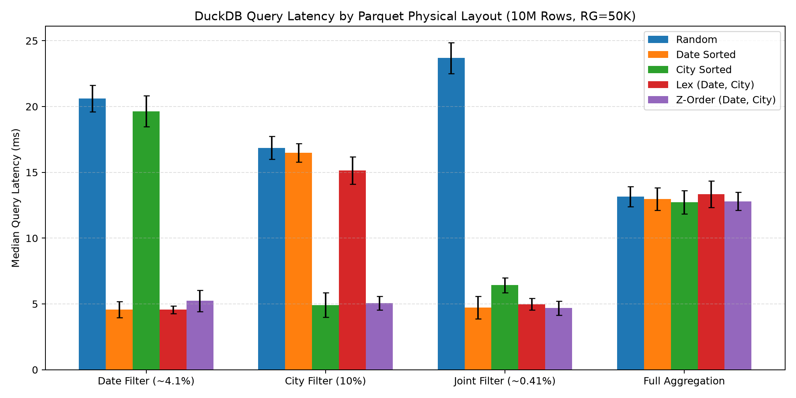
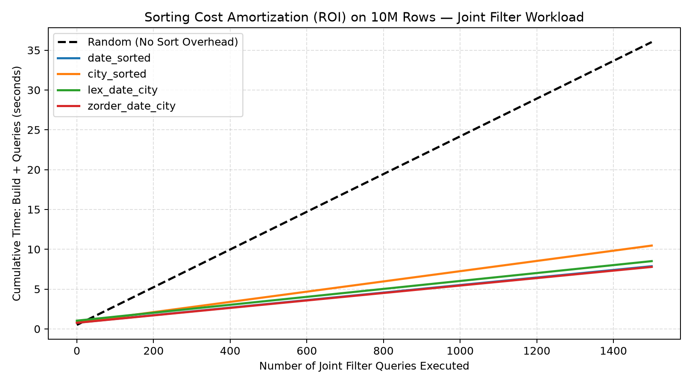
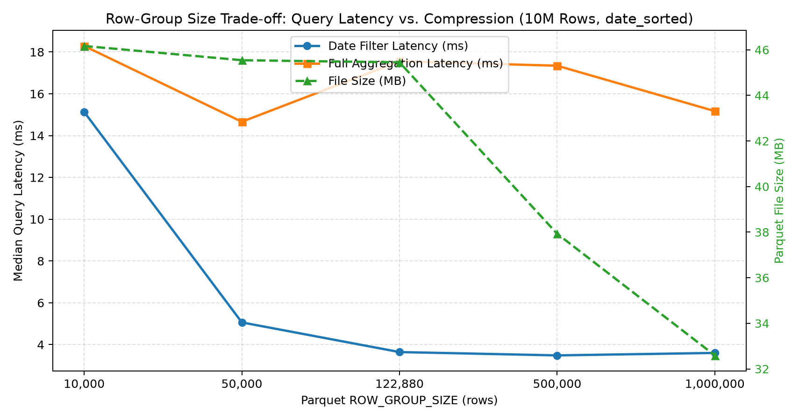
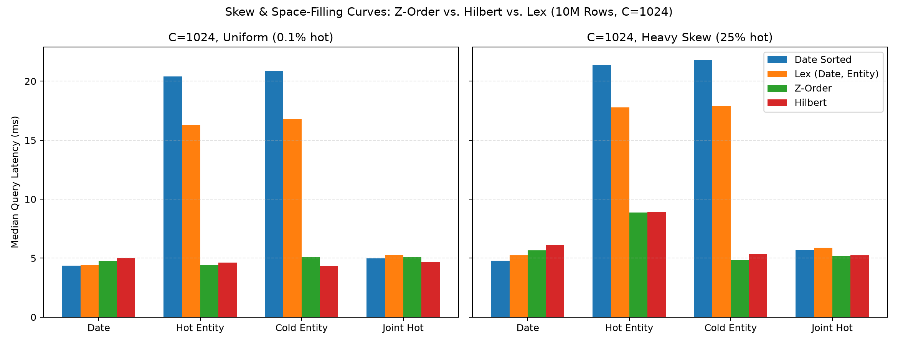

# DuckDB Parquet Physical Layout & Row-Group Pruning Study

An empirical study evaluating how **Parquet physical row ordering** and **row-group sizing** affect **DuckDB query latency, compression ratio, zone-map pruning, and sorting ROI**.

---

## Repository Structure

- `benchmark.py` — Original 1M-row single-column sorting benchmark (`random`, `date_sorted`, `city_sorted`).
- `research_experiments.py` — Extended 10M-row study comparing 5 physical layouts (including Lexicographical and 2D Z-order clustering), exact `parquet_metadata()` row-group pruning verification, sorting build-time ROI, and a `ROW_GROUP_SIZE` sensitivity sweep.
- `plot_results.py` — Generates publication-ready summary plots in `results/`.
- `results/` — Benchmark CSVs (`experiment1_layouts_10m.csv`, `experiment2_row_group_sweep_10m.csv`) and PNG charts.

---

## Key Findings (10,000,000 Rows)

### 1. Multi-Column Layouts: Z-Order vs. Lexicographical vs. Single-Column Sort
Evaluated at `ROW_GROUP_SIZE = 50,000` (196 row groups total) across 15 randomized rounds after 3 warm-up runs:

| Physical Layout | File Size (MB) | Build Time (s) | `date_filter` (~4.1%) | `city_filter` (10%) | `joint_filter` (~0.41%) | `full_aggregation` |
|---|---:|---:|---:|---:|---:|---:|
| `random` | 58.23 | 0.50 | 20.61 ms (0% pruned) | 16.86 ms (0% pruned) | 23.68 ms (0% pruned) | 13.15 ms |
| `date_sorted` | 45.54 | 0.78 | 4.58 ms (95.4% pruned) | 16.50 ms (0% pruned) | 4.73 ms (95.4% pruned) | 12.98 ms |
| `city_sorted` | 53.40 | 0.82 | 19.65 ms (0% pruned) | 4.92 ms (89.8% pruned) | 6.43 ms (89.8% pruned) | 12.74 ms |
| `lex_date_city` | **40.76** | 1.04 | **4.57 ms** (95.4% pruned) | 15.13 ms (0% pruned) | 4.98 ms (95.4% pruned) | 13.34 ms |
| `zorder_date_city` | 40.77 | 0.76 | 5.24 ms (88.8% pruned) | 5.06 ms (81.1% pruned) | **4.68 ms** (**96.9% pruned**) | **12.80 ms** |

**Takeaways:**
- **Z-order (`zorder_date_city`) enables 2D pruning:** Unlike `lex_date_city` (which gets **0% pruning** when filtering only on the secondary column `city`), Z-order prunes **88.8%** of row groups on `date_filter`, **81.1%** on `city_filter`, and **96.9%** on `joint_filter` (**5.06× faster** than `random`).
- **30% storage reduction:** Both `lex_date_city` and `zorder_date_city` shrink the Parquet file from **58.23 MB** down to **40.76–40.77 MB**.
- **Fast sorting ROI:** `zorder_date_city` adds only **0.26s** to build time over `random`, breaking even in **14–22 queries**.





---

### 2. Row-Group Size Sensitivity (`date_sorted`, 10M Rows)

| `ROW_GROUP_SIZE` | Total Row Groups | File Size (MB) | `date_filter` Scanned | `date_filter` Median | `full_aggregation` Median |
|---:|---:|---:|---:|---:|---:|
| 10,000 | 977 | 46.17 | 41 / 977 | 15.13 ms | 18.29 ms |
| 50,000 | 196 | 45.54 | 9 / 196 | 5.06 ms | 14.66 ms |
| 122,880 | 82 | 45.45 | 5 / 82 | 3.64 ms | 17.56 ms |
| 500,000 | 20 | 37.93 | 1 / 20 | **3.48 ms** | 17.34 ms |
| 1,000,000 | 10 | **32.59** | 1 / 10 | 3.60 ms | 15.17 ms |

**Takeaway:** Over-fragmenting into tiny row groups (`10,000` rows, 977 groups) hurts both compression (**46.17 MB**) and query latency (**15.13 ms** due to metadata/scheduling overhead). Larger row groups (`122,880`–`1,000,000`) achieve **3.48–3.64 ms** latency and up to **29.4% smaller** files.



---

### 3. Skew, Cardinality & Space-Filling Curves: Z-Order vs. Hilbert (`N = 10M`)
Evaluated across low (`C = 10`) and high (`C = 1,024`) entity cardinalities under **Uniform** vs. **Heavy Power-Law Skew** (`hot_id=0` at 63.1% for `C=10` and 25.0% for `C=1,024`):

- **Hilbert vs. Z-Order Trade-off:** Hilbert improves `date_filter` row-group pruning by only **2.5–3.6%** over Z-order (`90.8–92.3%` vs. `85.2–88.8%`) with virtually identical query latency, while costing **8.5×–10× more build time** (`5.36–6.59s` vs. `0.62–0.66s`).
- **Asymmetric Skew Collapse:** Under heavy skew, Z-order/Hilbert pruning on the hot entity drops from **85–93%** down to **33.7%** (`C=10`) and **51.0%** (`C=1024`), doubling `hot_entity` latency, while cold-tail pruning improves to **94.9–96.4%**.
- **High-Cardinality Compression:** At `C=1,024` with heavy skew, 2D space-filling curves (`hilbert`: **40.26 MB**, `zorder`: **40.77 MB**) compress better than `lex_date_entity` (**42.25 MB**) and `date_sorted` (**51.36 MB**).



---

## How to Reproduce

```bash
python3 -m venv .venv
source .venv/bin/activate
pip install -r requirements.txt

python research_experiments.py
python plot_results.py
```
